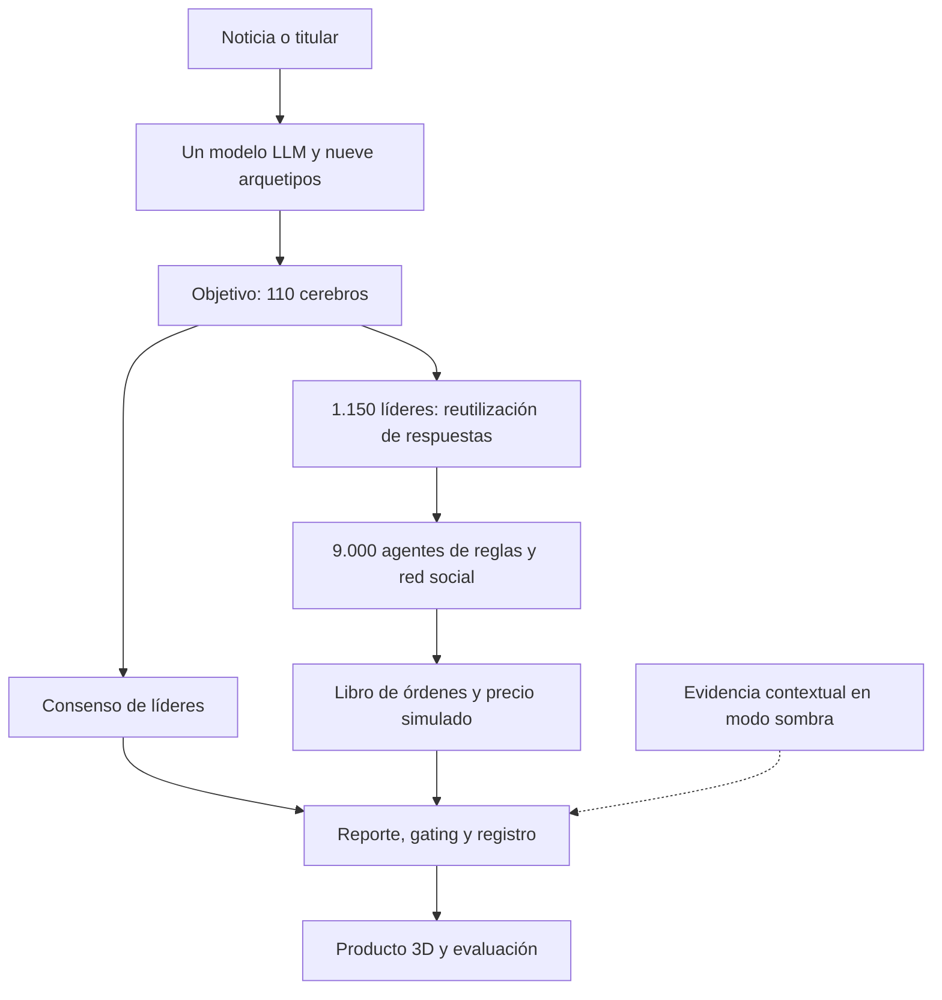
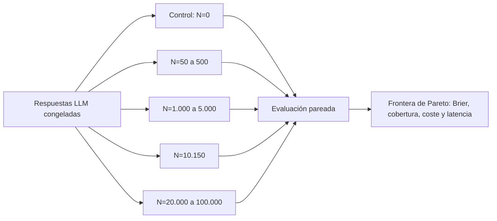
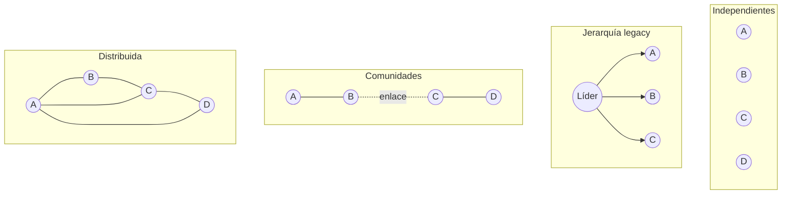
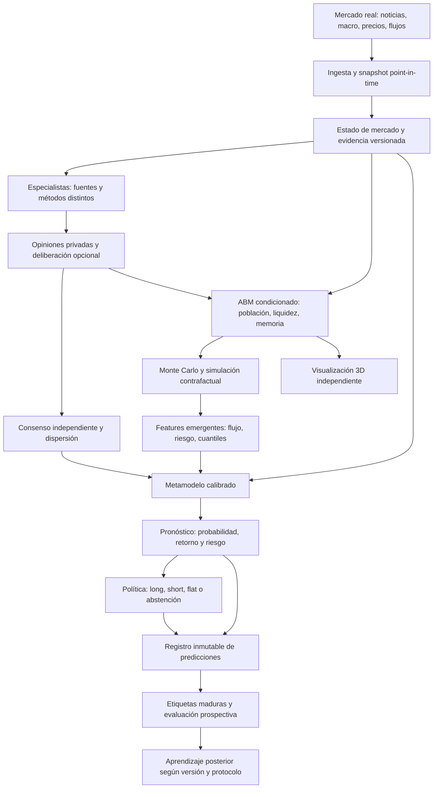
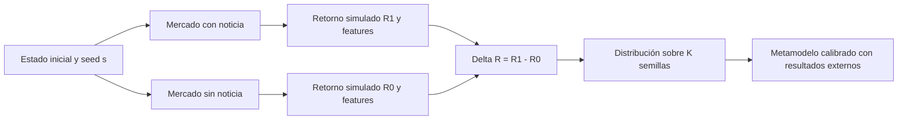
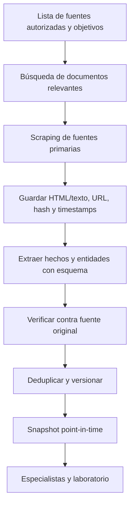

# EL ENJAMBRE 2.0 — Auditoría científica, tecnológica y plan maestro de investigación

**Rubicón Lab · Documento de ingeniería e investigación cuantitativa**  
**Estado:** propuesta de I+D; no certificación de capacidad predictiva ni recomendación de inversión.  
**Fuente primaria:** `codigo-fuente-enjambre(2).md`, volcado identificado por su encabezado como generado el 24-11-2026.  
**SHA-256 del volcado:** `8535f73517c514d00cdc89e4907bc7db833de925f3a76bc1bfb5eaa043213579`.

> **Misión:** comprobar o descartar, sin sesgos de confirmación, que una arquitectura de inteligencia colectiva y simulación de mercados aporta capacidad predictiva incremental, estadísticamente robusta y económicamente explotable.
>
> No se presupone que 10.150 agentes sean necesarios, suficientes ni óptimos. Tampoco se presupone que el ABM, los LLM, la manada, el doomer, los contrarians o la memoria deban mantenerse o desaparecer. Cada componente se juzgará con evidencia.

## Índice

1. [Resumen ejecutivo y alcance](#1-resumen-ejecutivo-y-alcance)
2. [Reconstrucción de la arquitectura](#2-reconstrucción-de-la-arquitectura)
3. [Auditoría de código y justificación](#3-auditoría-de-código-y-justificación)
4. [Pruebas reproducibles](#4-pruebas-reproducibles)
5. [Investigación científica y fuentes](#5-investigación-científica-y-fuentes)
6. [Definición del problema predictivo](#6-definición-del-problema-predictivo)
7. [Población, diversidad y topología](#7-población-diversidad-y-topología)
8. [Arquitectura El Enjambre 2.0](#8-arquitectura-el-enjambre-20)
9. [Datos y Firecrawl](#9-datos-y-firecrawl)
10. [Laboratorio experimental](#10-laboratorio-experimental)
11. [Estadística, potencia y validación económica](#11-estadística-potencia-y-validación-económica)
12. [Diseño técnico y contratos](#12-diseño-técnico-y-contratos)
13. [Plan maestro de ejecución](#13-plan-maestro-de-ejecución)
14. [Matriz de decisiones y veredicto](#14-matriz-de-decisiones-y-veredicto)
15. [Checklist e instrucciones para el equipo](#15-checklist-e-instrucciones-para-el-equipo)

---

## 1. Resumen ejecutivo y alcance

### 1.1 Dictamen

El Enjambre ya contiene elementos valiosos: simulación basada en agentes (ABM), libro de órdenes, heterogeneidad de reglas, red social, arquetipos LLM, caché versionada, calibración, ablación, registro prospectivo y mecanismos para corregir contaminación temporal. No recomiendo una reescritura indiscriminada.

Sin embargo, el código no demuestra por sí mismo que la emergencia colectiva genere una ventaja predictiva. La hipótesis más relevante es **si las variables del ABM añaden información útil sobre la que ya contiene un único LLM, el consenso de LLM y las variables financieras observadas**. El problema no se resuelve simplemente aumentando el número de agentes.

| Dimensión | Estado | Implicación |
|---|---|---|
| Simulación y producto | Arquitectura funcional según el volcado; no verificada en producción | Preservar como control y producto visual |
| Integridad sintáctica | 154 archivos Python parseados sin errores | Condición necesaria, no prueba funcional completa |
| Pruebas unitarias | 36 pruebas seleccionadas superadas en la reverificación | Las pruebas sintéticas no demuestran alpha |
| Integridad temporal | Cuatro comportamientos problemáticos reproducidos | Corregir antes de optimizar modelos |
| Predicción direccional de índices | Señal histórica declarada en comentarios del código | Recalcular con eventos y etiquetas verificables |
| Valor incremental del ABM | No demostrado | Experimento pareado con controles |
| Ventaja económica | No demostrada | Paper trading prospectivo y costes |

### 1.2 Evidencia, alcance y limitaciones

Se reconstruyeron localmente los 193 archivos incluidos en el Markdown, en una copia aislada. El índice del volcado declara 30.922 líneas: 160 archivos del motor, 25 del frontend y 8 de infraestructura. Se comprobó sintaxis de los 154 `.py` con `ast.parse`; se ejecutaron 36 tests seleccionados de ablación, evidencia, holdout y remediación temporal. En la ejecución adicional que incluía la batería walk-forward se agotó el tiempo de ejecución; no se presenta como aprobada. Se ejecutaron cuatro pruebas diagnósticas adicionales sobre funciones originales. Esta reverificación es la cifra de pruebas que puede citarse de forma reproducible, en lugar de atribuir al conjunto completo una cifra no documentada.

No se inspeccionó un commit remoto ni se comprobó que el despliegue corresponda exactamente al volcado. No se modificó el repositorio ni producción. El entorno local no contiene Mesa ni el SDK Anthropic; no se ejecutó el ABM completo ni se hicieron llamadas LLM. El volcado excluye bases SQLite y datos JSON históricos; por tanto, no es posible recalcular aquí las tasas de acierto, ejecutar un backtest real, estimar la correlación entre cerebros ni determinar el tamaño óptimo. Los resultados de papers son evidencia externa, no resultados del proyecto. La búsqueda científica se apoyó en Firecrawl; las referencias complementarias se listan con sus enlaces, sin afirmar haber replicado sus estudios.

**Convención de evidencia:**

- **R (reproducido):** comportamiento observado en ejecución local sintética.
- **C (código):** constatación por inspección estática del volcado.
- **D (declarado):** cifra o diagnóstico descrito en comentarios del proyecto, no recalculado.
- **H (hipótesis):** propuesta que exige experimento.

Las referencias `engine/...:línea` corresponden a archivos individuales reconstruidos, no a las líneas del Markdown exterior. La prioridad P0 indica bloqueo para certificar un resultado, P1 mejora importante, P2 investigación/optimización posterior.

### 1.3 Cuatro hipótesis distintas

1. El lenguaje de una noticia contiene señal sobre retornos futuros.
2. Un conjunto de cerebros heterogéneos supera a un único cerebro con la misma información y presupuesto comparable.
3. La simulación multiagente aporta señal incremental respecto al consenso y al contexto financiero.
4. La señal sigue siendo útil tras costes, latencia, riesgo, capacidad y degradación temporal.

La evidencia a favor de una no prueba las demás. Un predictor puede ser rentable sin ABM; un ABM puede ser científicamente útil para riesgo sin predecir dirección; un acierto superior al azar puede no monetizarse.

---

## 2. Reconstrucción de la arquitectura

### 2.1 Inventario

| Elemento | Valor confirmado en configuración/código |
|---|---:|
| Agentes | 10.150 |
| Líderes de opinión | 1.150 |
| Agentes no líderes | 9.000 |
| Arquetipos LLM | 9 |
| Cerebros objetivo | 110 |
| Modelos LLM configurados en `brains/cerebro.py` | 1 |

`engine/config/agentes.json` define las cantidades y el capital relativo. `brains/reparto.py:17,43–81` asigna los cerebros por arquetipo y expande sus respuestas. `brains/cerebro.py:20,138–165` usa un modelo configurado en código. El límite de 110 es un objetivo de reparto, no una garantía de 110 respuestas de API nuevas; puede haber caché, fallback u otra distribución dependiendo de la población.

### 2.2 Ilustración 1 — Flujo actual



**Interpretación:** el número de personas simuladas no es el número de fuentes informativas independientes. Una respuesta LLM copiada a diez líderes no constituye diez observaciones independientes. La simulación puede generar información de transformación (no linealidad, amplificación, liquidez) sin incorporar información externa adicional. Hay que medir esa transformación.

### 2.3 Composición real de la población

| Tipo | Cantidad | Capital relativo por agente |
|---|---:|---:|
| Fundamentalista | 370 | 50 |
| Quant momentum | 220 | 40 |
| Fondo pasivo | 150 | 60 |
| Market maker | 9 | 100 |
| Ejecutor TWAP/VWAP | 28 | 30 |
| Arbitrajista | 55 | 20 |
| Noise trader | 3.670 | 1 |
| Manada | 1.650 | 1 |
| FOMO | 1.100 | 1 |
| Miedoso | 920 | 1 |
| Contrarian | 460 | 1,5 |
| Buy and hold | 368 | 2 |
| Líder de opinión | 1.150 | 5 |
| **Total** | **10.150** | — |

Los nueve arquetipos: institucional frío, quant escéptico, FOMO evangelista, doomer, contrarian sabio, macro trader, influencer optimista, value paciente y doomer selectivo. Su distribución y conectividad no deben confundirse con su valor predictivo marginal. El capital relativo y número de agentes pueden cambiar por separado; una población más grande puede alterar artificialmente la liquidez si no se controla el capital total.

### 2.4 Resultados históricos documentados, no certificados

`engine/server.py:665–675` describe aproximadamente 63% para consenso y 57% para precio simulado en índices, según medición histórica corregida. `engine/contenido/senal_prediccion.py:45–53` documenta aproximadamente 80% condicional para índices con señal fuerte, con reducción de cobertura. `model.py` describe la antigua evaluación circular, y que fuera de índices la dirección agregada quedó alrededor del azar. No se dispone aquí de numeradores, denominadores completos, distribución de eventos, ni resultados independientes para certificar esas cifras.

**Ilustración 2 — Comparación declarada, no backtest nuevo:**

```text
Consenso de líderes     63% |███████████████████████████████▌                  |
Precio ABM             57% |████████████████████████████▌                     |
Referencia 50/50       50% |█████████████████████████                         |
```

El 50% es una referencia teórica de moneda equilibrada, no un benchmark suficiente si los índices muestran deriva alcista. La diferencia aproximada de seis puntos no establece significancia, ni significa que el ABM sea inútil. Se requiere comparación pareada, misma muestra, misma cobertura y bandas de error. Los 616 casos mencionados en comentarios y 678 casos de una ablación histórica no deben mezclarse como si fueran un único dataset.

### 2.5 Lo que preservaría

- La implementación de reservas de efectivo y acciones del libro (`market/order_book.py`, `agents/base.py`), más sus tests de invariantes.
- La separación existente entre consenso y magnitud simulada, incluida la advertencia de que convicción no equivale a probabilidad.
- El caché versionado por modelo/prompt/esquema, el fallback identificado y la instrumentación por tipo de agente.
- El diseño de ablación A0–A5, el walk-forward anidado, el holdout con hash y el registro prospectivo, corrigiendo sus contratos.
- Los hechos estilizados y el benchmark de rendimiento como controles de realismo y coste, no de alpha.

---

## 3. Auditoría de código y justificación

### 3.1 Registro de hallazgos

| ID | Prioridad | Evidencia | Hallazgo | Efecto posible |
|---|---|---|---|---|
| F01 | P0 | R | Walk-forward usa `pct_real` | Optimización contra etiqueta histórica contaminada |
| F02 | P0 | R | Baseline A0 actualiza resultados sin maduración | Benchmark con información no disponible |
| F03 | P0 | R | `event_timestamp` futuro aceptado | Evidencia aparentemente válida fuera del corte |
| F04 | P0 | R | Partición posterior ignora embargo guardado | Reintroducción de filas purgadas |
| F05 | P0 | C | Selección histórica por movimientos extremos | Muestra no representativa del flujo real |
| F06 | P0 | C | Etiqueta basada en fechas, no disponibilidad exacta | Horizonte distinto al ejecutable; posible solape |
| F07 | P1 | C | Reutilización de cerebros homogéneos | Pseudodiversidad y falsa precisión |
| F08 | P1 | C | Semilla no controla la generación remota | Reproducibilidad parcial |
| F09 | P1 | C | Evidencia recogida después de predecir | Contexto no utilizado |
| F10 | P1 | C | Lookback insuficiente para variables de 20 sesiones | Features ausentes o mal rotuladas |
| F11 | P1 | C | Gating editorial y abstención no equivalentes | Evaluación mezcla visualización y predicción |
| F12 | P1 | C | Inicialización 50/50, precio artificial y reinicio | Estado inicial no condicionado |
| F13 | P1 | C | Memoria no actualizada en ruta textual | Pérdida de dependencia histórica |
| F14 | P1 | C | Bootstrap por dimensiones separadas y fallback IID | Incertidumbre insuficientemente identificada |
| F15 | P1 | C | Unión de titulares por símbolo y fecha | Posibles colisiones de eventos |
| F16 | P1 | C | Perfil inferido del titular y señal común multi-activo | Exposición equivocada de instrumentos |
| F17 | P1 | C/H | Límites de escala en la red | Microsociedades pueden bloquearse al construir vecinos |
| F18 | P2 | C/H | Magnitud recortada y ticks sin tiempo de mercado calibrado | Interpretación indebida del retorno y riesgo |

### F01 — Contrato de etiquetas inconsistente (P0, reproducido)

**Código:** `engine/calibration/walk_forward.py:52–68`, `remedir_sin_fuga.py:67–103`, `ablacion.py:33–45`.

```python
# walk_forward.cargar
r = c["reaccion_real"]
pct = r.get("pct_real")
```

El proyecto dispone de `pct_corr` para excluir el salto histórico usado para seleccionar el evento, pero el walk-forward consume `pct_real`. Si recibe el export original, el calibrador puede aprender la etiqueta antigua. No afirmo que toda corrida real del calibrador esté contaminada: no tenemos los archivos efectivamente utilizados. El defecto es que su interfaz no lo impide.

**Prueba:** etiqueta original +2%, corregida -2%; `cargar` devuelve clase 1 en vez de 0. **Justificación:** separar train/test temporalmente no elimina fuga presente en la definición de y. **Cambio:** crear contrato `LabelV2` que exija `event_id`, retorno, método, instrumento, `entry_at`, `exit_at`, `label_available_at`, versión y fuente. Rechazar la etiqueta histórica no certificada en el laboratorio de predicción. No sustituir silenciosamente `pct_real` por otro campo: verificar semántica y procedencia, pues en la libreta prospectiva un campo del mismo nombre puede representar una etiqueta legítima. **Aceptación:** prueba de signos contradictorios, rechazo de etiquetas sin metadata y comparación de resultados legacy vs v2 con igual universo.

### F02 — Baseline que aprende resultados no maduros (P0, reproducido)

**Código:** `calibration/ablacion.py:58–80`, `walk_forward.py:80–102`. A0 ordena por fecha y actualiza contadores inmediatamente después de cada observación. El walk-forward usa embargo por número de filas, con cero por defecto. En una muestra de tres ETF del mismo día, dos reciben predicción informada por el resultado del primero, aunque la etiqueta se conozca días después.

**Justificación:** el baseline puede quedar artificialmente fortalecido y, por extensión, cualquier comparación distorsionada. Además, un fold con registros temporalmente solapados puede filtrar etiquetas al modelo. **Cambio:** agrupar anuncios por identificador canónico y evaluar todos los registros del mismo instante con un modelo congelado. Actualizar historia solo cuando `label_available_at <= fit_cutoff` y purgar solapes de horizontes. **Aceptación:** los tres ETF con etiquetas no maduras no alteran el baseline; permutar orden dentro de un anuncio no cambia resultados.

### F03 — Contrato point-in-time admite evento posterior al corte (P0, reproducido)

**Código:** `evidence/contrato.py:35–98`. Valida `published_at` y vintage de expectativas, pero almacena `event_timestamp` sin comparar con `as_of`. Se aceptó un evento a las 11:00Z con corte 10:00Z.

**Justificación:** una fecha en el futuro puede contaminar una predicción aun con hash válido. El hash verifica integridad del contenido, no su validez causal. **Cambio:** validar timestamps UTC explícitos de publicación, observación, recepción, revisión y evento observado. Una fecha futura programada (ej. próximo FOMC) es información admisible si se conocía antes, pero debe vivir como `scheduled_at`, no como hecho realizado. Conservar también versiones históricas. **Aceptación:** rechazar evento observado posterior al corte, fuente revisada no disponible y timestamps ambiguos; admitir calendario futuro conocido con su vintage.

### F04 — Embargo del holdout no aplicado al reparticionar (P0, reproducido)

**Código:** `calibration/holdout.py:38–66,86–104`. `construir_manifiesto` excluye del desarrollo las fechas dentro del embargo. `particionar` solo excluye ids del holdout y registros posteriores al corte, sin usar `embargo_dias`.

**Prueba:** diez días consecutivos, holdout 20%, embargo dos días. El manifiesto declara seis filas de desarrollo, pero `particionar` devuelve ocho; los días 7 y 8 vuelven a entrar. **Justificación:** el hash del holdout puede seguir correcto mientras se invalida la separación del entrenamiento. **Cambio:** congelar membresía de desarrollo elegible o reconstruir el filtro de embargo, usando además ventanas de disponibilidad de etiquetas. Hash de dataset, ids, etiquetas, features y versión de código; reservar holdout realmente sellado. **Aceptación:** el tamaño y las filas de desarrollo coinciden con el manifiesto; añadir casos posteriores no altera el holdout ni el desarrollo; rechazar duplicados e ids faltantes.

### F05 — Cosecha condicionada al resultado futuro (P0, código)

**Código:** `contenido/cosechador.py:140–188,192–239,244–285`. Selecciona primero días de grandes movimientos y después noticias cercanas; la categoría positiva/negativa se obtiene del retorno. `calibration/ablacion.py:33` y `remedir_sin_fuga.py:105–142` además condicionan varios diagnósticos a `abs(pct_corr) >= 0.3`.

**Justificación:** aunque la ventana posterior esté corregida, seleccionar noticias por el movimiento observado produce un universo distinto del flujo que se enfrentará en vivo. Excluir a posteriori movimientos pequeños hace que el acierto condicional no equivalga al acierto operable. **Cambio:** dos datasets: (A) shocks, para dinámica; (B) flujo cronológico completo con reglas de inclusión observables ex ante, para predicción. Separar categoría editorial de `realized_direction`. Registrar noticias sin efecto, errores de fuente, duplicados y abstenciones. **Aceptación:** cohorte de flujo sin filtro por retorno futuro y reporte de métricas de todas las noticias elegibles; magnitud posterior solo como diagnóstico.

### F06 — Horizonte de etiqueta y tiempo real (P0, código)

**Código:** `calibration/remedir_sin_fuga.py:46–81`; `contenido/resolver_predicciones.py:21–61`. La remediación toma el cierre de la rueda siguiente a `fecha_base` y mide dos ruedas posteriores por defecto; el resolvedor prospectivo toma la primera fecha posterior a `as_of_iso[:10]`. Es conservador respecto a ciertos movimientos ya observados, pero no garantiza el primer precio ejecutable después de una predicción intradía. `fecha_base` puede ser la fecha del movimiento seleccionado, no la publicación exacta.

**Justificación:** evitar fuga no es lo mismo que alinear el objetivo con la latencia y el uso del producto. Una predicción de reacción inmediata no se juzga igual que un retorno a dos sesiones después del cierre siguiente. La fecha UTC y la sesión de bolsa pueden diferir. **Cambio:** calendario por exchange, timestamps intradía, precios bid/ask cuando se evalúe ejecución y definición explícita de entrada y salida; excluir barras todavía abiertas, revisar ajustes corporativos y cobertura. Mantener el horizonte legacy como referencia separada. **Aceptación:** tests para antes/después de apertura, feriados, horario de verano, noticias nocturnas, cripto 24/7 y barras incompletas.

### F07 — Diversidad nominal frente a efectiva (P1, código)

**Código:** `brains/reparto.py:17,43–81`, `brains/cerebro.py:20,138–165`, `model.py:378–485`. 1.150 líderes comparten respuestas de aproximadamente 110 cerebros del mismo modelo. Las personalidades no garantizan independencia; el tono global vuelve a difundir la señal y la red puede reforzar copias.

**Justificación:** la correlación de errores limita el beneficio del ensemble. Replicar respuestas puede dar mayor peso social a una misma opinión. **Cambio:** almacenar `brain_id`, respuesta única, modelo, familia, especialidad y asignación; comparar agregación por cerebro, arquetipo, capital y confianza calibrada; diversificar datos y modelos, incluyendo señales no generativas. **Aceptación:** matriz OOS de correlación de residuos, mejora pareada frente a único LLM, coste por evento y efecto de redistribuir copias manteniendo respuestas fijas.

### F08 — Semilla y caché no garantizan reproducción completa (P1, código)

**Código:** `brains/cerebro.py:57–85,138–205`. El caché incluye titular, arquetipo, semilla y versión del prompt/modelo/esquema; `messages.create` no recibe esa semilla como control de generación. `fuente` identifica API/caché/fallback.

**Justificación:** una nueva llamada al servicio puede variar aunque tenga idéntica semilla local; las respuestas guardadas pueden reproducir un experimento, pero no todas las condiciones del servicio. **Cambio:** separar seed ABM y seed de muestreo donde el proveedor lo soporte; guardar request/response sanitizados, configuración, modelo efectivo y versión, hash de evidencia, fecha de recepción y fallback. Incluir activo, horizonte y evidencia en claves futuras, no únicamente titular. Nunca almacenar secretos. **Aceptación:** replay de respuestas congeladas produce la misma entrada al ABM; reporte de reproducibilidad y resultados por fuente; no mezclar fallback con LLM real sin identificarlo.

### F09 — Evidencia contextual en sombra (P1, código)

**Código:** `contenido/pipeline.py:31–65,76–114`; `brains/cerebro.py:138–153`; `evidence/recoleccion.py`, `evidence/contrato.py:103–134`. La simulación consulta el titular; posteriormente, al registrar pronóstico, se construye y almacena evidencia. El propio comentario dice que no cambia la predicción.

**Justificación:** una noticia adquiere significado distinto según expectativas, posicionamiento, volatilidad y cuánto está descontado. La información recopilada después no debe atribuirse retroactivamente al pronóstico. **Cambio:** recopilar y congelar evidencia antes de iniciar cerebros; emitir pronóstico con hash del objeto realmente consumido. Registrar variante titular-only y variante contextual simultáneamente. **Aceptación:** mock captura el prompt con contexto, verifica hash y timestamps; nueva evidencia posterior no muta la predicción emitida; comparación fuera de muestra con coste y latencia.

### F10 — Ventana de contexto insuficiente (P1, código)

**Código:** `evidence/fuentes.py:17,26–62` importa `calibration/remedir_sin_fuga.obtener_barras`; esta última solicita 12 días naturales previos (`:46–65`). `ret_20` necesita 21 cierres, imposibles normalmente con esa ventana. `dist_max20` se calcula con hasta 20 observaciones, aun cuando solo haya seis.

**Justificación:** la falta de historia produce features omitidas o con significado inconsistente; un máximo de seis sesiones no es uno de veinte. **Cambio:** adaptador separado que solicite al menos 60–90 días naturales o un número suficiente de sesiones, compruebe conteo y orden, etiquete ventanas efectivas y missingness. **Aceptación:** 21 cierres completos producen `ret_20`; menos de 20 no se etiqueta como máximo de 20; sin barras futuras, duplicadas o inválidas.

### F11 — Política predictiva y abstención incoherentes (P1, código)

**Código:** `server.py:661–684`; `contenido/pipeline.py:31,61–65`; `contenido/senal_prediccion.py:72–95`. Cuando la señal es fuerte y fiable se usa dirección del consenso. Si no, `direccion_titular` refleja el precio simulado. El registro usa `abstenido=(direccion == "neutra")`, incluso si `fiable_direccion=False` y el precio no es neutro.

**Justificación:** una flecha visual no es necesariamente un pronóstico. Mezclarlas impide medir cobertura y precisión selectiva. **Cambio:** conservar `simulation_direction`, `forecast_direction`, probabilidad y `decision` explícita (long/short/flat/abstain según protocolo); versiones independientes para política editorial y científica. **Aceptación:** una simulación bajista con evidencia insuficiente sigue visualizándose como bajista, pero registra abstención; se guardan todos los eventos; se calculan métricas de cobertura.

### F12 — Mercado inicial artificial (P1, código)

**Código:** `agents/base.py:9–18`; `model.py` constructor; `contenido/pipeline.py:88–114`. Capital inicial 50% efectivo y 50% acciones; precio sintético, calentamiento y reinicio por evento. Además, venta corta limitada a acciones disponibles: no reproduce automáticamente inventarios institucionales ni short covering real.

**Justificación:** un modelo de reacciones artificiales puede generar hechos estilizados sin estar calibrado al estado real de mercado. **Cambio:** comparar estado sintético, estado condicionado a volatilidad/liquidez/retornos y estado inferido persistente; distribución de inventarios y capital validada mediante momentos observables, sin afirmar observar carteras individuales privadas. **Aceptación:** mismas noticias bajo estados distintos, mejora OOS frente a contexto sin ABM; conservación de efectivo y acciones, estabilidad ante escalas.

### F13 — Memoria no equivalente entre noticias numéricas y textuales (P1, código)

**Código:** `model.py:367–410`, `agents/base.py:45–61`, `contenido/pipeline.py:88`. `aplicar_noticia()` llama `actualizar_memoria()` para los agentes; `aplicar_titular()` asigna señales, tono y propagación sin esa actualización. Cada titular del pipeline crea mercado nuevo.

**Justificación:** el sistema no explota de forma homogénea el efecto acumulado de noticias. Repetir un titular no debería equivaler a un evento inesperado independiente. **Cambio:** unificar actualización de memoria con identificadores de eventos; implementar decaimiento temporal y deduplicación; replay de secuencias sin mirar el futuro. **Aceptación:** secuencia de eventos reproduce estado persistente, no cuenta dos veces el mismo evento y compara memoria on/off OOS.

### F14 — Incertidumbre y dependencia (P1, código)

**Código:** `calibration/intervalos_multiway.py:1–20,42–72`; `calibration/ablacion.py:192–231`. El código reconoce que tomar el intervalo más ancho de varios bootstrap unidimensionales es una heurística, no inferencia multiway garantizada. Con un solo grupo `_ci_por_clave` cae a filas IID, y `gate_pareado` con un único evento puede dar un intervalo degenerado. Agrupar por fecha tampoco siempre identifica la noticia canónica.

**Justificación:** cuatro ETF reaccionando a una misma noticia no son cuatro acontecimientos independientes. **Cambio:** reportar `n_events`, `n_assets`, bloques y tamaño efectivo; con insuficientes clusters declarar incertidumbre no estimable; comparación pareada por evento y bloques temporales, análisis leave-one-event/regime-out. Usar métodos de dependencia apropiados tras revisar sus supuestos. **Aceptación:** un solo grupo no genera falsa significancia; casos repetidos no inflan potencia; reportar intervalo y tamaño muestral.

### F15 — Unión potencialmente ambigua de titulares (P1, código)

**Código:** `calibration/ablacion.py:97–115` usa `setdefault` por `(fecha_base, simbolo)` para recuperar el titular del export crudo. Si hay dos titulares para el mismo instrumento y día, puede reutilizar el primero. `gate_pareado` agrupa por fecha. **Justificación:** un emparejamiento erróneo atribuye señal de una noticia a otra. **Cambio:** `event_id` canónico, `instrument_id`, `forecast_id`, horizonte y versión de etiqueta como claves; detectar duplicados y validar cardinalidad. **Aceptación:** dos noticias el mismo día conservan sus propios textos y resultados. La frecuencia real del defecto queda pendiente de datos.

### F16 — Clasificación por titular y pronóstico común a varios activos (P1, código)

**Código:** `contenido/pipeline.py:28–65,100–104`, `brains/mercado.py`. El perfil se elige clasificando el titular; luego se registra la misma dirección para cada símbolo mencionado. **Justificación:** un aumento del petróleo puede beneficiar una petrolera y perjudicar una aerolínea; USD, bonos y acciones pueden reaccionar en sentidos distintos. **Cambio:** resolver entidad e instrumento antes de la predicción; cerebros informados del ticker, tipo, exposición y horizonte; modelar efectos cruzados. **Aceptación:** ejemplos multi-activo con direcciones separadas y sin copiar automáticamente el resultado.

### F17 — Escalabilidad de la red y casos pequeños (P1, código/hipótesis)

**Código:** `network/red.py:35–88,110–119`. La red requiere líderes para manada/FOMO y pretende asignar 3–8 pares sociales, sin comprobar explícitamente si hay suficientes nodos para cumplir esa meta. En microsociedades, un bucle `while` podría no terminar; no se ejecutó esa ruta porque Mesa no está disponible. Las preferencias y seguidores también se apoyan en arquetipos estáticos. **Justificación:** reducir la población requiere adaptar grafo y liquidez, no solo cambiar `total_agentes`. **Cambio:** validador de poblaciones, acotar grados a candidatos elegibles, salida para cero líderes, semilla y topología explícitas. **Aceptación:** construcción para N=0 (sin ABM), 50, 100 y todas las escalas sin bucles infinitos; métricas de grado, densidad y conectividad; presupuesto computacional controlado.

### F18 — Ticks, recortes y valor económico (P2, código/hipótesis)

**Código:** `model.py` (`FACTORES_LIQUIDEZ`, `_aplicar_perfil`, `step`), `server.py:636–654`, `calibration/benchmark_motor.py`. El precio virtual se reporta con recortes de magnitud por mercado; el código conserva valor crudo, lo cual es positivo. El retorno por tick no equivale automáticamente a retorno por minuto o sesión real.

**Justificación:** mejorar la plausibilidad visual o recortar extremos no prueba calibración de magnitud. **Cambio:** calibrar relación tick/tiempo por objetivo, usar retornos crudos, cuantiles y métricas probabilísticas; medir saturación, spread, impacto, volumen y hechos estilizados. **Aceptación:** comparación de distribuciones reales vs simuladas condicionada por régimen y prueba de forecasting, no confundir ambas.

---

## 4. Pruebas reproducibles

### 4.1 Verificación ejecutada

```text
Archivos reconstruidos: 193
Archivos Python parseados: 154
Errores de sintaxis: 0
36 passed in 0.25s (tests seleccionados)
```

Comando ejecutado desde `engine/` en la reconstrucción local:

```bash
PYTHONPATH=. pytest -q validation/test_ablacion.py \
  validation/test_evidencia.py validation/test_holdout.py \
  validation/test_remedir_sin_fuga.py --disable-warnings
```

La duración es específica del entorno de auditoría, no benchmark de producción. Una ejecución que añadió `test_walk_forward.py` no terminó dentro del límite; no se contabiliza como aprobada. La batería completa depende de las versiones fijadas en `requirements.txt` y datos excluidos del volcado.

### 4.2 Script para reproducir los cuatro hallazgos P0

Guardar temporalmente como `engine/research/repro_auditoria.py` (propuesta; no archivo existente). Ejecutar desde `engine/` con `PYTHONPATH=.`. Este script diagnostica la versión actual; una vez corregida, convertir cada comportamiento esperado en test de regresión de la nueva interfaz.

```python
import json
import tempfile
from calibration import walk_forward as w, ablacion as a
from calibration.holdout import construir_manifiesto, particionar
from evidence import contrato as c

sa = {k: {"senal_media": 0.1, "n": 1} for k in w.BASE}
with tempfile.NamedTemporaryFile(mode="w", suffix=".json") as f:
    json.dump([{
        "fecha": "2026-01-01",
        "reaccion_real": {"pct_real": 2, "pct_corr": -2},
        "senales_arquetipo": sa,
        "direccion_pct": 1,
    }], f)
    f.flush()
    print("F01 clase esperada 0; obtenida:", w.cargar(f.name)[0]["y"])

filas = [
    {"fecha": "2026-01-01", "simbolo": s, "pct_corr": 1}
    for s in ("SPY", "QQQ", "DIA")
]
print("F02 predicciones de A0 sin historia madura:", a._items_a0(filas))

try:
    ev = c.construir_evidencia(
        event_id="e", activo="SPY", titular="test",
        as_of="2026-01-01T10:00:00Z",
        event_timestamp="2026-01-01T11:00:00Z",
    )
    print("F03 evento futuro aceptado:", ev["event_timestamp"])
except c.EvidenciaInvalida:
    print("F03 evento futuro rechazado")

casos = [
    {"id": str(i), "fecha": f"2026-01-{i:02d}", "y": i % 2}
    for i in range(1, 11)
]
m = construir_manifiesto(casos, pct_holdout=20, embargo_dias=2)
dev, hold = particionar(casos, m)
print("F04 desarrollo declarado vs real:", m["n_desarrollo"], len(dev))
```

Resultados observados:

| Prueba | Esperado para un contrato temporal estricto | Actual |
|---|---|---|
| F01 | 0 o rechazo de etiqueta no certificada | 1 |
| F02 | 0 predicciones informadas por etiquetas no maduras | 2 predicciones para QQQ y DIA |
| F03 | Rechazo de evento observado posterior | Aceptado |
| F04 | 6 filas de desarrollo | 8 filas |

### 4.3 Tests nuevos obligatorios

Además de las pruebas de cada hallazgo: replay determinista con respuestas guardadas; conservación de efectivo/inventario; errores y reintentos LLM; clasificación ticker; features no futuras; idempotencia de pronóstico; transacción de persistencia; timeouts; duplicados; paralelismo; simulaciones con semillas distintas; coste y memoria por variante; fallback separado; exportaciones compatibles y migraciones reversibles. No confundir cobertura de tests con validez predictiva.

---

## 5. Investigación científica y fuentes

### 5.1 Referencias y aplicación al proyecto

Se realizó búsqueda de literatura mediante Firecrawl Research sobre LLM, predicción financiera, dependencia de ensembles y contaminación temporal. Las siguientes referencias incluyen trabajos localizados en esa búsqueda y literatura complementaria pertinente. Una publicación (especialmente preprint) no certifica resultados de El Enjambre. Las propuestas de ingeniería son inferencias a contrastar; no se presentan como reproducciones de los papers.

| Referencia | Aportación relevante | Experimento derivado / límite |
|---|---|---|
| López-Lira y Tang, [Can ChatGPT Forecast Stock Price Movements?](https://arxiv.org/abs/2304.07619) | Estudia capacidad de modelos de lenguaje para extraer señal de noticias y retornos posteriores. | M4/M5: un LLM como adversario directo. No demuestra validez universal ni alpha de un ABM. |
| Byrd et al., [ABIDES](https://arxiv.org/abs/1904.12066), [código](https://github.com/abides-sim/abides) | Simulación de mercado de eventos discretos y agentes con microestructura. | Comparar latencia, libro y ejecución; realismo simulado no implica forecast. |
| Lorenz et al. (2011), [How social influence can undermine the wisdom of crowd effect](https://doi.org/10.1073/pnas.1008636108) | La influencia social puede reducir diversidad y deteriorar la sabiduría colectiva. | Opiniones privadas vs deliberación; topologías y contagio. No extrapolar automáticamente experimentos humanos a LLM financieros. |
| [DatedGPT: Preventing Lookahead Bias in Large Language Models with Time-Aware Pretraining](https://arxiv.org/abs/2603.11838) | El resumen recuperado por Firecrawl describe modelos con cortes anuales estrictos y riesgo de que un LLM conozca resultados históricos. | Modelos con cutoff anterior al evento y evaluación prospectiva; anonimizar titulares como sensibilidad, no garantía de eliminar memoria. |
| [FININ: Modeling News Interactions and Influence for Financial Market Prediction](https://arxiv.org/abs/2410.10614) | El resumen recuperado estudia relaciones noticia-noticia y noticia-precio en múltiples fuentes, y reporta mejoras en su propio benchmark. | Memoria de eventos, novedosidad y relaciones; replicar con splits propios. |
| Cont, Kukanov y Stoikov, [The Price Impact of Order Book Events](https://arxiv.org/abs/1011.6402) | Relación entre order-flow imbalance, profundidad y variación de precio a corto plazo. | Incorporar microestructura real y comparar con OFI sin ABM. |
| Bailey y López de Prado, [The Deflated Sharpe Ratio](https://doi.org/10.3905/jpm.2014.40.5.094) | Ajuste de evaluación por selección de estrategias y no normalidad. | Registrar todos los ensayos y corregir sesgo de selección; no usar DSR como garantía única. |
| [FNSPID](https://arxiv.org/abs/2402.06698) | Firecrawl recuperó un dataset académico de noticias y precios alineados temporalmente. | Explorar cobertura y licencias; auditar timestamps, universo y supervivencia antes de usarlo. |
| [Temporal Data Meets LLM](https://arxiv.org/abs/2306.11025) | Firecrawl recuperó investigación que combina variables de mercado y noticias para predicción explicable. | Titular vs contexto, y modelos textuales frente a híbridos. |
| [Predictive Power of LLMs in Financial Markets](https://arxiv.org/abs/2411.16569) | Firecrawl recuperó un estudio de información macro textual (Beige Book) y modelos de lenguaje. | Evaluar por familias de eventos macro, no solo sentimiento genérico. |
| [A Review of Large Language Models for Stock Price Forecasting from a Hedge-Fund Perspective](https://arxiv.org/abs/2605.05211) | Resumen de Firecrawl destaca diseño del horizonte, fuga y fricciones. | Revisión metodológica de evaluación económica. Preprint; validar calidad. |
| [Financial Language Models as Applied Artificial Intelligence Systems for News-Based Trading under Market Frictions](https://arxiv.org/abs/2609.23703) | Firecrawl recuperó un marco de observabilidad temporal, calibración, costes y operación. | Protocolo integrado de forecast y paper trading; preprint, no prueba independiente. |

### 5.2 La ventaja no surge por cantidad

El valor del ensemble depende de la calidad, correlación y complementariedad de sus errores. Si todos leen idéntico titular y usan el mismo modelo, sus discrepancias pueden consistir en cambios de estilo o muestreo. La influencia social puede destruir diversidad. Un buen diseño debe permitir independencia inicial, deliberación controlada y evaluación de la contribución de cada mecanismo.

### 5.3 Contaminación temporal del propio LLM

Aunque el dataset sea point-in-time, un modelo entrenado después del evento puede recordar el resultado. La fecha exacta, empresa, cifras y nombres pueden actuar como pistas. Anonimización, reformulación, comparación con modelos de cutoff documentado y controles negativos son sensibilidades útiles; la prueba decisiva es registrar predicciones antes de observar sus resultados, con versiones congeladas. No es suficiente decirle al modelo que ignore el futuro.

### 5.4 Simular bien no significa predecir bien

Validar colas gruesas de retornos, agrupamiento de volatilidad, impacto y spread comprueba realismo estadístico. Para predecir necesitamos además demostrar que características del ABM reducen la pérdida predictiva respecto a información externa y consenso disponibles en el mismo instante. Es una prueba de utilidad incremental, no de parecido visual.

---

## 6. Definición del problema predictivo

### 6.1 Objetivos y horizonte

Hipótesis primaria propuesta: en eventos macro de EE. UU. con instrumento SPY (y réplica QQQ, DIA, IWM), un modelo híbrido que incorpora variables del ABM reduce Brier frente al mejor modelo sin ABM con idéntica información y presupuesto comparable. Prerregistrar horizonte principal de dos sesiones para continuidad con el proyecto, especificando exactamente entrada/salida. Si se cambia a 30 minutos o una sesión, tratarlo como estudio nuevo, no elegir retrospectivamente el que mejor funciona.

Objetivos secundarios: retorno esperado, dirección, cuantiles, volatilidad realizada, cambio de régimen, fragilidad de liquidez, contagio entre activos, y probabilidad de drawdown. Separar experimentos por clase de activo (índice, acción, cripto, oro, petróleo). No declarar que otros mercados son imposibles: el titular aislado pudo ser insuficiente.

### 6.2 Línea temporal — Ilustración 3


Restricción: `observed_at <= available_at <= information_cutoff <= issued_at <= entry_at < exit_at <= label_available_at`. Para fuentes o calendarios con hechos futuros programados, distinguir `scheduled_at` de `available_at`. Para un entrenamiento con corte t, usar solo etiquetas maduras y features disponibles a sus respectivos cortes. No usar noticias corregidas a posteriori ni precios anteriores a la emisión como si fueran ejecutables.

### 6.3 Definición de targets

- Retorno bruto: `r = P_exit / P_entry - 1`, con metodología de ajuste y divisa explícitas.
- Dirección binaria: `y = 1 si r > 0, 0 si r < 0`; definir empates previamente (p. ej. clase neutral separada). No excluir movimientos pequeños por su resultado salvo análisis secundario.
- Target económico: retorno neto de costes de entrada/salida, spread, slippage, financiación y préstamo cuando corresponda; para estrategia de índices comparar retorno excedente al benchmark de riesgo.
- Target probabilístico de volatilidad: magnitud/varianza realizada o cuantiles de retorno futuro.
- Abstención: decisión observable antes del resultado, no etiqueta determinada por retorno pequeño posterior.

---
## 7. Población, diversidad y topología

### 7.1 ¿Cuántos agentes necesitamos?

No adoptar 10.150 como dogma. Separar cuatro cantidades: N de agentes conductuales, B de cerebros únicos, A de arquetipos y G de fuentes/modelos independientes. El número óptimo para predecir dirección puede no coincidir con el número óptimo para reproducir microestructura o crear una buena visualización.

| N | Experimento |
|---:|---|
| 0 | Modelo sin ABM: consenso y contexto; control principal |
| 50 | Microsociedad; solo con red y cuotas compatibles |
| 100 | Microsociedad ampliada |
| 250 | Diversidad de reglas básica |
| 500 | Enjambre compacto |
| 1.000 | Complejidad intermedia |
| 2.500 | Mercado mediano |
| 5.000 | Comparación de escala |
| 10.150 | Configuración legacy |
| 20.000 | Escalamiento |
| 50.000 | Saturación y coste |
| 100.000 | Límite experimental, solo si hay evidencia y recursos |

B a probar: 1, 3, 9, 18, 36, 55, 110, 220, con restricciones de viabilidad. Para B menor que número de arquetipos, seleccionar explícitamente una variante de especialistas; para B mayor que líderes, cambiar el reparto. Comparar un cerebro neutral con el conjunto. No ejecutar inicialmente el producto cartesiano completo de N×B×red×régimen×modelo: se dispararía coste y multiplicidad. Usar diseño secuencial o factorial fraccional en desarrollo, con confirmación posterior de las interacciones importantes.

### 7.2 Controles de escala

Para medir el efecto causal de N dentro del modelo:

1. Congelar evento, evidencia, respuestas cerebrales, horizonte, configuración y semillas comparables.
2. Ajustar el número de representantes por tipo con reparto proporcional y mínimos explícitos para roles esenciales.
3. Mantener capital agregado por arquetipo y activo constante; si cada agente nuevo conserva capital original, N altera capital y profundidad a la vez.
4. Controlar inventario inicial, liquidez, ritmo de órdenes y grado medio de la red, por separado. Verificar invariantes de mercado. Un agente ponderado puede representar varios individuos, pero las reglas de matching y órdenes deben adaptarse de forma consistente.
5. Para estudiar profundidad económica, ejecutar un experimento separado que sí cambie capital/liquidez junto con N.
6. Medir tiempo de construcción de red, memoria, ticks/seg, latencia, coste por forecast y rendimiento predictivo. No confundir mayor precisión numérica Monte Carlo con mayor acierto real.

**Ilustración 4 — Diseño del barrido (no curva de resultados):**



**Criterio:** elegir la variante más simple y barata entre las que demuestren rendimiento no inferior dentro de un margen preregistrado, o mayor valor neto. Si 500 agentes y 10.150 son equivalentes estadísticamente, no afirmar superioridad del menor N sin potencia de equivalencia. Si 100.000 no mejora, no concluir que nunca mejorará: solo no hay evidencia bajo los escenarios y presupuesto probados.

### 7.3 Tamaño efectivo de un conjunto de opiniones

Bajo una simplificación de errores con varianza igual y correlación común ρ, la varianza del promedio equivale a la de un número efectivo de opiniones independientes:

$$N_{efectivo}=\frac{N}{1+(N-1)\rho}$$

| N de cerebros | ρ = 0 | ρ = 0,01 | ρ = 0,10 | ρ = 0,30 | ρ = 0,50 | ρ = 1 |
|---:|---:|---:|---:|---:|---:|---:|
| 9 | 9,00 | 8,33 | 5,00 | 2,65 | 1,80 | 1,00 |
| 36 | 36,00 | 26,67 | 8,00 | 3,13 | 1,95 | 1,00 |
| 110 | 110,00 | 52,63 | 9,24 | 3,26 | 1,98 | 1,00 |
| 220 | 220,00 | 68,97 | 9,61 | 3,30 | 1,99 | 1,00 |
| 1.000 | 1.000,00 | 90,99 | 9,91 | 3,33 | 2,00 | 1,00 |

**Ilustración 5 — 110 cerebros: independencia efectiva hipotética.** Cada bloque representa aproximadamente 5 opiniones efectivas; valores redondeados y barra con mínimo visual.

```text
ρ=0,00  110,00   ██████████████████████
ρ=0,01   52,63   ███████████
ρ=0,10    9,24   ██
ρ=0,30    3,26   ▋
ρ=0,50    1,98   ▍
ρ=1,00    1,00   ▏
```

No son mediciones de El Enjambre. Para estimar dependencia real, usar errores probabilísticos OOS `e_i = p_i - y`, covarianza por familias, bootstrap por evento y correlación residual condicionada a régimen. Controlar que modelos calibrados con tasas base distintas no parezcan artificialmente diversos. Para pesos heterogéneos, analizar `wᵀΣw`, evitando invertir una matriz ruidosa; regularización/shrinkage en desarrollo. No aumentar diversidad a costa de calidad individual sin demostrar utilidad del ensemble.

### 7.4 Topología social y deliberación

**Ilustración 6 — Cuatro estructuras a comparar.**



Comparar sin red, red actual, comunidades, redes aleatorias con grado igualado, redes de información parcialmente independientes y un grafo causal de eventos/activos. Variar intensidad de contagio, retrasos, número de saltos, tasa de decaimiento, grados, relación líderes-seguidores y realimentación. Probar controles de rumor permutado, misma opinión copiada, opiniones independientes y evidencia permutada dentro de un régimen.

**Protocolo de deliberación:** primera ronda privada (guardar probabilidades, supuestos, evidencia y desacuerdo); segunda ronda de intercambio de argumentos y contraargumentos con citas; tercera ronda de actualización opcional. Medir diferencia pareada antes/después y coste adicional. Un agente escéptico debe poder revisar una evidencia sin obligar a adoptar la opinión mayoritaria. Evaluar si la deliberación corrige errores o induce cascadas informativas.

### 7.5 Ablación de arquetipos y capital

Conservar todos los tipos al comienzo. Leave-one-out, add-one-in, permutación de señales por arquetipo, pesos iguales por cerebro vs pesos de capital, y variación de composición. Ajustar en desarrollo únicamente. Incluir doomer original y selectivo como variantes distintas: el peso del doomer selectivo en tono y la contribución a la señal predictiva son mecanismos diferentes. Un agente con mal acierto individual puede mejorar estimación de incertidumbre, liquidez, dispersión o compensar errores de otro. No eliminarlo solo por accuracy individual.

---

## 8. Arquitectura El Enjambre 2.0

### 8.1 Arquitectura dual: predictor separado de la visualización



La arquitectura conserva el motor actual como control. La interfaz pública no debe confundir el precio del universo virtual con el pronóstico calibrado. El metamodelo puede decidir que el ABM no aporta valor direccional en algunos segmentos y aun así emplearlo como laboratorio de fragilidad o simulación de escenarios. Una variante no validada permanece en modo sombra.

### 8.2 Especialistas: diversidad de información, no solo de personalidad

| Especialidad | Inputs disponibles al corte | Output contrastable | Justificación |
|---|---|---|---|
| Macro | CPI, empleo, GDP, tipos, vintages | Impacto probable sobre curvas y activos | Los regímenes macro modifican sensibilidad |
| Expectativas | Consenso antes de la publicación, valor anterior, actual | Sorpresa estandarizada | El precio descuenta expectativas |
| Quant | Retornos, momentum, volatilidad, factores | Probabilidad/retorno condicional | Control no narrativo |
| Fundamental | SEC, resultados, guidance, valoración | Cambio de valor esperado | Específico de instrumento y horizonte |
| Microestructura | Spread, profundidad, OFI, volumen | Fragilidad/impacto a corto plazo | La misma noticia tiene efectos distintos según liquidez |
| Intermercado | Bonos, dólar, commodities, índices | Vector de sensibilidades | Propagación entre activos |
| Posicionamiento | Proxies públicos o licenciados, COT, opciones | Riesgo de squeeze/unwind | Inventario latente condiciona la reacción; proxies con retrasos |
| Noticias | Fuente, novedad, entidad, repetición, hechos | Score de sorpresa y fiabilidad | No todos los titulares contienen información nueva |
| Régimen | Volatilidad, tendencia, correlaciones, calendario | Distribución de régimen causal | Efectos no estacionarios |
| Escéptico | Evidencia contradictoria y fuentes | Contraargumentos verificables | Reduce errores compartidos y sobreconfianza |
| Contrafactual | Contexto sin shock | Retorno esperado en escenario base | Aísla reacción incremental dentro del modelo |
| Incertidumbre | Missingness, dispersión, fiabilidad histórica | Señal de abstención y ancho de intervalo | Separa conocimiento de seguridad subjetiva |

Implementar especialistas deterministas y estadísticos donde sea suficiente. LLM se utiliza para comprensión semántica, extracción estructurada y argumentos con soporte. No inventar cifras de consenso, posicionamiento o datos faltantes. Incluir un canal de incertidumbre explícito y exigir que cada hecho citado exista en el snapshot. Roles y personalidades legacy siguen siendo factores experimentales.

### 8.3 El agente de sorpresas: ejemplo hipotético

```text
Inflación previa:       3,5 %
Inflación esperada:     2,8 %
Inflación publicada:   3,1 %
Cambio vs previo:     -0,4 puntos porcentuales
Sorpresa vs consenso: +0,3 puntos porcentuales
```

Interpretación superficial: la inflación cayó; noticia aparentemente positiva. Interpretación contextual: la inflación superó el consenso; podría alterar expectativas de tipos y afectar negativamente a activos sensibles. No hay regla universal: importan componentes de la inflación, revisiones, posicionamiento, régimen y reacción previa de precios. El ejemplo es ficticio y no pronostica un evento real.

Sorpresa cuantitativa propuesta: `(actual - consenso_previo) / sigma_historica_del_error_de_consenso`, con desviación calculada solo en entrenamiento. Distinguir sorpresa de revisión anterior, divergencia de expectativas y credibilidad. Probar signo y magnitud frente a un modelo que solo conoce el titular.

### 8.4 Memoria y novedad

Construir grafo de eventos, instrumentos, entidades, macro y exposiciones. Cada actualización incluye publicación original, fecha de ingesta, id de evento, versión y relación con noticias anteriores. Para el estado persistente, estimar decaimiento por horizonte y régimen. Comparar memoria de texto, memoria de features y memoria de carteras. Controlar repetición, duplicación de agencias, traducciones y republicaciones; un rumor no se convierte en diez evidencias por aparecer en diez sitios.

### 8.5 Monte Carlo y contrafactuales

En vez de una sola trayectoria, realizar K réplicas bajo el mismo snapshot y respuestas cerebrales congeladas. Empezar con K=5–10 en piloto y aumentar (20, 40, 100 o más) si la varianza Monte Carlo afecta la estabilidad del forecast. Las semillas son réplicas de simulación, no eventos de mercado independientes. Para medir incertidumbre total, distinguir ruido de simulación, incertidumbre de cerebros, parámetros, estado inicial y resultado real.



**Ilustración 7 — futuros sintéticos, sin datos reales.**

```text
Precio virtual
110 |                                ╱  escenario superior
105 |                    ╭───────╱──╯
100 |●───────────╮───────┼────────── mediana aproximada
 95 |             ╰───────╮─────╲
 90 |                      ╰──────╲── escenario inferior
    +---------------------------------------> tiempo simulado
     shock de información                 horizonte
```

Features: fracción de trayectorias alcistas, mediana, cuantiles 5/25/75/95, expected shortfall virtual, volatilidad, drawdown, velocidad de reacción, order-flow imbalance, spread, inventario, profundidad, dispersión de señales y diferencia de trayectoria con/sin noticia. Conservar features crudas y transformadas. La frecuencia de trayectorias alcistas no es automáticamente probabilidad del mundo real; calibrar contra resultados observados. El contrafactual ABM mide efecto dentro del simulador, no causalidad identificada en el mercado real.

### 8.6 Calibrar dinámica real sin confundirla con forecast

Calibración estructural: comparar volatilidad, colas, autocorrelaciones de retornos y volatilidad, spread, volumen, OFI e impacto condicionados por activo/régimen. Calibración predictiva: comparar error de distribución y probabilidades a horizontes definidos. Ajustar parámetros estructurales en desarrollo; usar métodos simples (moment matching, simulated method of moments, búsqueda bayesiana controlada) antes de RL. Si varios conjuntos de parámetros reproducen los mismos hechos, reconocer no identificabilidad y analizar sensibilidad. No optimizar un simulador hasta que calce perfectamente cada trayectoria histórica.

---

## 9. Datos y Firecrawl

### 9.1 Capas de datos

| Fuente | Uso | Precaución |
|---|---|---|
| [ALFRED](https://alfred.stlouisfed.org/) y [FRED](https://fred.stlouisfed.org/) | Macroeconomía y vintages | Consultar versión disponible al corte, no la serie final revisada |
| [Federal Reserve](https://www.federalreserve.gov/) | FOMC, discursos, comunicados | Capturar hora exacta, texto original y calendario |
| [BLS](https://www.bls.gov/) | CPI, empleo, precios | Revisiones y calendario; no inventar consenso de mercado |
| [BEA](https://www.bea.gov/) | PIB, PCE, consumo | Versiones y frecuencia |
| [SEC EDGAR](https://www.sec.gov/edgar/search/) | Filings, resultados, información corporativa | Fecha de aceptación y disponibilidad, límites de acceso |
| [Alpaca](https://alpaca.markets/) | Datos y noticias, según plan/cobertura | SIP/IEX, licencia, latencia, universo, calidad |
| [CBOE](https://www.cboe.com/) | Volatilidad y derivados | Cobertura histórica y derechos de uso |
| [Databento](https://databento.com/) | Eventos de mercado y microestructura | Coste, venue, timestamps y licencias |
| [FNSPID](https://arxiv.org/abs/2402.06698) | Banco académico de noticias/precios | Sesgos y licencias; no asumir timestamps perfectos |
| Proveedor de consensos históricos licenciado | Expectativas ex ante | Exigir vintage anterior al release; evaluar presupuesto |

Los links son puntos de partida para evaluar disponibilidad, no afirmación de que todos los datos estén ya conectados, sean gratuitos o tengan licencia comercial. Para precios ejecutables, cotizaciones o calendarios profesionales, usar APIs y feeds apropiados. Firecrawl es adecuado para información textual y documental, no un sustituto de una fuente de market data en tiempo real.

### 9.2 Workflow propuesto de Firecrawl



Para investigación externa, Firecrawl Search/Research permite descubrir artículos, papers y documentación; scraping selectivo puede extraer comunicados, informes y fuentes oficiales que permitan acceso. Antes de incorporar nuevos adaptadores, evaluar términos, robots, licencias, límites, atribución y datos personales. No sortear paywalls ni enviar código privado o credenciales al proveedor externo. En histórico, la fecha de scraping actual no prueba qué contenido existía entonces; exigir archivos/versiones confiables. Guardar provenance por hecho, no solo URL de la página. Tratar texto web como dato no confiable, evitar que instrucciones incrustadas modifiquen prompts o acciones y validar JSON contra esquema.

### 9.3 Construcción de bancos

- **Banco A — shocks:** conservar cosecha existente, etiqueta corregida y diagnóstico de contagio. No usar como única evidencia de predicción general.
- **Banco B — universo cronológico:** ingestar todos los eventos elegibles por reglas previas a los resultados. Versionar universo de símbolos y evitar survivorship bias.
- **Banco C — prospectivo sellado:** toda emisión tras activar una versión, con abstenciones y fallos; publicación/ingesta/ejecución registradas automáticamente.
- **Banco D — estrés y controles:** titular permutado, placebo, noticias viejas, noticias duplicadas, eventos fuera de horario, cambios de régimen y fallos de proveedor.

Fuentes y eventos se asignan a `canonical_event_id`; un anuncio macro con varios activos es un cluster, no múltiples observaciones independientes. Incluir disponibilidad de etiquetado, latencia y missingness. No imputar datos con conocimiento posterior.

---

## 10. Laboratorio experimental

### 10.1 Torneo de modelos

| ID | Modelo | Pregunta / comparación |
|---|---|---|
| M0 | Tasa base train-only, siempre alcista y moneda equilibrada | ¿Existe señal más allá de deriva y azar? |
| M1 | Momentum, reversión, volatilidad | ¿Supera reglas simples? |
| M2 | Léxico de titulares | ¿El LLM supera sentimiento básico? |
| M3 | Logística regularizada de features financieras | ¿Texto/ABM añaden valor a contexto numérico? |
| M4 | Un único LLM neutral, titular-only | ¿Los cerebros múltiples mejoran el resultado? |
| M5 | Un LLM con evidencia contextual idéntica | ¿Ensemble supera un cerebro bien informado? |
| M6 | Ensemble de cerebros privados e independientes | ¿Diversidad agrega señal? |
| M7 | ABM legacy 10.150 (A4) | ¿Precio virtual supera consenso? |
| M8 | ABM con evidencia contextual | ¿El contexto mejora el modelo de agentes? |
| M9 | ABM sin influencia social | ¿Contagio aporta o destruye señal? |
| M10 | Ensemble heterogéneo y ABM especializado | ¿La diversidad útil supera personalidades? |
| M11 | ABM multi-seed y contrafactual | ¿Distribución mejora trayectoria única? |
| M12 | ABM condicionado a microestructura | ¿Simulación añade algo sobre OFI real? |
| M13 | Híbrido contexto + consenso + features ABM | ¿Existe valor incremental conjunto? |
| M13-null | Mismo metamodelo sin features ABM | Control directo de M13, misma información y validación |

Conservar A0/A1/A2/A3/A4/A5 para compatibilidad con `calibration/ablacion.py`. M13 vs M13-null es la comparación primaria propuesta. M6 vs M5 y M7 vs A3 son comparaciones secundarias críticas. Usar presupuestos de computación comparables cuando se estudie mérito del ensemble, además de una comparación a máxima calidad permitida.

### 10.2 Matriz de hipótesis falsables

| ID | Hipótesis | Diseño controlado | Resultado adverso y decisión |
|---|---|---|---|
| H01 | Más agentes mejoran forecast | Barrido N, B y capital constantes | Meseta: seleccionar menor N elegible |
| H02 | Más cerebros mejoran forecast | Variar B con N constante | Sin mejora: limitar coste |
| H03 | Diversidad supera cantidad | Mismo B, distintas familias/inputs | Sin mejora: investigar errores y fuentes |
| H04 | Red de influencia agrega valor | Red on/off con respuestas congeladas | Daño: reducir contagio predictor, conservarlo en simulador |
| H05 | La manada destruye señal | Intensidad y topología de contagio | Efecto mixto: especializar por régimen tras confirmar |
| H06 | Contexto mejora titular | M4 vs M5 y M7 vs M8 | No mejora: auditar calidad/latencia y revisar features |
| H07 | Memoria es útil | Reinicio vs persistencia, eventos cronológicos | Daño: eliminar memoria predictiva o regularizarla |
| H08 | Especialistas superan arquetipos | Roles genéricos vs datos especializados | No mejora: conservar arquitectura más simple |
| H09 | ABM añade valor incremental | M13 vs M13-null, misma información | No evidencia: ABM sigue visual/experimental |
| H10 | Regímenes necesitan expertos | Universal vs mezcla de expertos causal | No mejora: modelo universal más robusto |
| H11 | Microestructura mejora la precisión | Contexto OFI vs mismo contexto + ABM | No mejora incremental: usar OFI directamente |
| H12 | Existe ventaja económica | Registro futuro + paper trading neto | Sin valor neto: no desplegar estrategia real |
| H13 | Deliberación mejora opiniones privadas | Antes vs después, presupuesto/latencia registrados | Conformismo: conservar primera ronda |
| H14 | ABM predice riesgo mejor que dirección | Pinball/CRPS y volatilidad vs baselines | Especializar en riesgo si confirma valor |
| H15 | Señal no es memoria del LLM | Cutoffs, controles negativos, cohorte futura | Caída fuerte: no promocionar backtest antiguo |

Todos los resultados, incluidos negativos, quedan registrados. No cambiar la métrica primaria después de ver el test. En una familia de experimentos controlar selección múltiple con un protocolo jerárquico, Holm/FDR cuando proceda y confirmación en datos frescos. Hipótesis no probadas por falta de potencia quedan como inconclusas, no falsas.

### 10.3 Secuencia de experimentación y presupuesto

**Etapa piloto:** corregir P0; datos de desarrollo; comparar M0–M7 con respuestas guardadas; perfil de N y K en un subconjunto estratificado definido antes de mirar resultados; estimar varianza, coste y correlación. 

**Etapa exploratoria:** diseño factorial fraccional N×B×topología; especialistas, evidencia, memoria, perfiles de mercado. Mantener controles y semillas comunes. Seleccionar candidatos usando solo validación interna temporal. Registrar todas las ejecuciones, incluidos fallos y resultados nulos. 

**Etapa confirmatoria:** configuración congelada, comparación primaria pareada, holdout sellado por evento y tiempo. Después de abrirlo, no reutilizarlo como juez de la siguiente variante. Los nuevos candidatos requieren otra cohorte de confirmación. 

**Etapa prospectiva:** correr legacy, mejor no-ABM y mejor ABM en paralelo, con el mismo feed y timestamps. Reportar resultados al madurar etiquetas y auditar deriva. No ajustar reglas dentro de una cohorte congelada; cualquier cambio crea otra versión.

Estimación de coste: si E eventos × B cerebros únicos × V variantes requieren nueva inferencia, coste LLM ≈ E·B·V·precio medio por consulta (más tokens de entrada/salida y reintentos). Reusar respuestas solo cuando el input, modelo, prompt y configuración sean idénticos. Coste ABM ≈ E·V·K·tiempo_sim(N), medido localmente por `benchmark_motor.py` y pruebas de carga. Definir máximo de llamadas, horas CPU, memoria y SLA antes de cada fase. No usar 100.000 agentes por defecto en producción.

### 10.4 Configuración experimental ilustrativa, copiable

```yaml
experiment_id: enjambre_abm_incremental_v1
status: proposed_not_executed
primary_market: indice
primary_symbol: SPY
replication_symbols: [QQQ, DIA, IWM]
primary_horizon: 2_sessions
primary_target: direction_from_executable_entry
primary_metric: paired_brier_improvement
primary_comparison: [M13, M13-null]
secondary_comparisons: [[M6, M5], [M7, A3]]
# Fijar márgenes y potencia usando desarrollo antes de abrir holdout.
population_grid: [50, 100, 250, 500, 1000, 2500, 5000, 10150, 20000, 50000, 100000]
brain_grid: [1, 3, 9, 18, 36, 55, 110, 220]
network_grid: [none, legacy, communities, distributed]
seeds_pilot: [11, 23, 37, 53, 71]
monte_carlo_grid: [5, 10, 20, 40, 100]
controls:
  fixed_event_snapshot: true
  fixed_total_capital: true
  fixed_initial_liquidity: true
  fixed_horizon: true
  common_random_numbers: true
  keep_missingness: true
  record_all_trials: true
validation:
  split_unit: canonical_event_id
  purge_overlapping_labels: true
  require_label_available_at: true
  frozen_holdout: true
  nested_walk_forward: true
  future_prospective_cohort: true
```

Este YAML es especificación de desarrollo, no un archivo de configuración que el motor actual pueda ejecutar sin implementar el runner. Definir combinaciones admisibles de N/B y grafo. Usar una tabla de manifestaciones de cada corrida con hash de código, snapshot, parámetros y etiqueta.

---

## 11. Estadística, potencia y validación económica

### 11.1 Métricas

| Dimensión | Métrica | Definición/interpretación |
|---|---|---|
| Dirección | Accuracy | Fracción de signos correctos; informar denominador |
| Dirección | Balanced accuracy, MCC | Control de balance de clases y asociación |
| Probabilidad | Brier | Media de `(p-y)^2`; menor es mejor |
| Probabilidad | Brier skill score | `1 - BS_modelo / BS_baseline` si baseline > 0 |
| Probabilidad | Log loss | Penaliza confianza errónea, clipping solo numérico |
| Calibración | Reliability diagram, ECE, MCE | Diagnóstico de calibración; ECE sensible a bins |
| Selección | Coverage / risk-coverage | Fracción de eventos elegibles predichos y error condicional |
| Retorno | IC, Spearman | Asociación señal-retorno y ordenación |
| Distribución | Pinball loss, CRPS | Calidad de cuantiles/distribuciones |
| Valor económico | P&L, Sharpe, Sortino, DSR | Rentabilidad neta ajustada al riesgo y selección |
| Riesgo | Drawdown máximo, expected shortfall | Riesgo de pérdidas y cola |
| Operación | Profit factor, turnover, latencia, coste | Viabilidad y capacidad |

No comparar accuracy de un modelo que se abstiene en 95% de casos con uno que predice todos sin igualar cobertura. Registrar probabilidades para todos los casos que el modelo pueda evaluar y decisiones separadas, reportar errores/faltantes. Comparar predicciones en intersección y reportar universo completo e intención de cobertura. El criterio económico debe incorporar coste de no operar y posiciones solapadas.

### 11.2 Contraste primario pareado

Por cada evento-instrumento-horizonte comparable, definir:

$$d_i = (p_{sinABM,i}-y_i)^2 - (p_{conABM,i}-y_i)^2$$

Promedio positivo favorece al ABM. Agrupar por evento canónico y bloques temporales cuando haya dependencia; predefinir ponderación por evento o por instrumento. Reportar media, intervalo, eventos independientes aproximados, proporción de victorias y estabilidad por subperiodo. No contar semillas o múltiples ETF del mismo anuncio como réplicas independientes.

Para accuracy usar diferencia pareada de aciertos y, cuando supuestos lo permitan, McNemar/cluster bootstrap; para pérdidas temporales, métodos tipo Diebold-Mariano con corrección de dependencia si proceden. Para estrategias usar retornos de cartera en serie temporal y block bootstrap. Los intervalos deben reflejar el esquema de muestreo y las dependencias. Si faltan clusters, el veredicto es insuficiencia de evidencia.

### 11.3 Potencia estadística ilustrativa

Aproximación para detectar diferencia entre accuracy verdadero y 50%, con α bilateral 5% y potencia 80%, bajo independencia. Los números son orientativos de una prueba de proporción simple, no potencia del torneo pareado.

| Acierto hipotético | N independiente aproximado |
|---:|---:|
| 52% | 4.900 |
| 53% | 2.180 |
| 55% | 780 |
| 60% | 195 |
| 65% | 85 |

La referencia debe ser la tasa base del mercado o el mejor benchmark, no necesariamente 50%. Una mejora de 2 puntos requiere miles de observaciones independientes. Para comparar dos predictores, la potencia depende de la varianza de sus diferencias, en especial de los desacuerdos. Estimar varianza y tamaños de bloque con datos de desarrollo; simular potencia por clusters antes de fijar tamaño confirmatorio. Evitar optional stopping: establecer ventana de evaluación o diseño secuencial con control de error y reglas de parada predefinidas.

### 11.4 Validación cronológica


En cada fold: ajustar preprocessors y calibradores solo con train; no usar estadísticas del conjunto completo; purgar eventos y ventanas solapadas; usar etiquetas maduras; guardar predicción de test sin ajustar a ella. El holdout debe congelar fechas, ids, evidencia, target, versión y hashes. Si se ajusta un modelo después de ver el holdout, ya no es un examen independiente de esa variante. Para generalización entre activos, añadir test leave-one-symbol/sector-out distinto del test temporal.

### 11.5 Criterios de promoción sugeridos

Estos criterios son propuesta, no resultados ni umbrales demostrados. Fijar los valores concretos en el prerregistro usando desarrollo y exigencias económicas:

- Brier significativamente menor que M13-null, con mejora mínima económicamente relevante (`delta_min`); `0.005` de diferencia absoluta es un candidato inicial por continuidad con el margen del walk-forward existente, no garantía de valor.
- Log loss y calibración no materialmente degradados; sensibilidad a periodos, clases y activos.
- Coverage mínimo predefinido y comparación a igual cobertura; evaluar fallos del sistema.
- Coste y latencia dentro de SLA, sin introducir información futura.
- Mejora confirmada en una cohorte prospectiva independiente; si se evalúan muchos modelos, controlar selección múltiple.
- Paper trading neto positivo frente a controles apropiados, con riesgo y turnover predefinidos. Si no hay evidencia económica, no afirmar ventaja explotable.

**Veredicto científico:** superioridad si la mejora supera margen y su intervalo lo respalda; inferioridad si el intervalo respalda degradación; equivalencia/no inferioridad solo con diseño y margen explícitos; inconcluso si intervalo amplio. Ausencia de evidencia no equivale a evidencia de ausencia.

### 11.6 Paper trading y ejecución realista

Para convertir señal en decisión, estimar retorno esperado neto y riesgo; aplicar posición y exposición predefinidas. No basta con `p_up > 0.5`: importan tamaño de subidas/bajadas, costes y distribución. Simular entrada al primer precio ejecutable posterior a emisión con latencia real, spreads, slippage, comisiones, financiación, restricciones de ventas cortas y horarios. Incorporar posiciones simultáneas, límites de riesgo y capacidad. Comparar con buy-and-hold de índice cuando proceda, cash, momentum, modelo sin ABM y cartera con misma exposición/riesgo. Reportar tanto retornos absolutos como incrementales ajustados por riesgo. Evaluar sensibilidad a costes 1x/2x y retraso de ejecución, sin seleccionar escenario favorable a posteriori.

No operar capital real basándose en la presente auditoría. La transición a ejecución real requeriría revisión de riesgo, obligaciones regulatorias, datos, supervisión, controles y evidencia independiente. El objetivo de la investigación no es prometer rentabilidad.

---

## 12. Diseño técnico y contratos

### 12.1 Estructura de módulos propuesta

```text
engine/
├── agents/                   # existentes; parametrizar sin romper legacy
├── brains/                   # existentes; interfaces de modelo y evidencia
├── market/                   # libro de órdenes y estado condicionado
├── network/                  # topologías y controles de escala
├── contenido/                # producto y visualización, desacoplados del forecast
├── evidence/
│   ├── contrato.py           # endurecer el existente
│   ├── macro.py
│   ├── expectativas.py
│   ├── noticias.py
│   ├── microestructura.py
│   └── estado_mercado.py
├── predictor/
│   ├── forecast.py
│   ├── ensemble.py
│   ├── especialistas.py
│   ├── correlacion.py
│   ├── monte_carlo.py
│   ├── metamodelo.py
│   ├── regimen.py
│   └── abstencion.py
├── research/
│   ├── experimentos.py
│   ├── poblacion.py
│   ├── diversidad.py
│   ├── topologias.py
│   ├── contrafactual.py
│   ├── torneo.py
│   └── registro.py
├── calibration/
│   ├── etiquetas_pit.py
│   ├── baselines.py          # corregir existente
│   ├── walk_forward.py       # corregir existente
│   ├── holdout.py            # corregir existente
│   ├── potencia.py
│   └── evaluacion_economica.py
└── validation/               # pruebas unitarias, integración, regresión
```

No crear duplicados de componentes que ya funcionen; adaptar sus interfaces, preservar backwards compatibility mediante migraciones y trabajar en rama aislada. `research` no debe depender del frontend ni de credenciales de producción para replay offline. Mantener configuraciones versionadas y un default legacy.

### 12.2 Contratos de predicción y etiqueta (esqueleto)

```python
from dataclasses import dataclass
from datetime import datetime

@dataclass(frozen=True)
class Forecast:
    forecast_id: str
    event_id: str
    symbol: str
    issued_at: datetime
    information_cutoff: datetime
    horizon: str
    probability_up: float | None
    expected_return: float | None
    uncertainty: float | None
    simulation_direction: str | None
    forecast_direction: str | None
    decision: str             # long / short / flat / abstain
    model_version: str
    evidence_hash: str
    configuration_hash: str
    experiment_id: str
    agent_count: int
    brain_count: int
    simulation_seeds: tuple[int, ...]
    response_bundle_hash: str

@dataclass(frozen=True)
class LabelV2:
    forecast_id: str
    event_id: str
    symbol: str
    entry_at: datetime
    exit_at: datetime
    label_available_at: datetime
    raw_return: float
    net_return: float | None
    target_version: str
    price_source_hash: str


def check_temporal(f: Forecast, label: LabelV2) -> None:
    assert f.forecast_id == label.forecast_id
    assert f.event_id == label.event_id
    assert f.symbol == label.symbol
    assert f.information_cutoff <= f.issued_at <= label.entry_at
    assert label.entry_at < label.exit_at <= label.label_available_at


def eligible_train(records, fit_cutoff):
    return [r for r in records
            if r.label.label_available_at <= fit_cutoff
            and r.forecast.issued_at < fit_cutoff]
```

El código es un ejemplo de interfaz, no implementación lista para producción. Añadir validación de timezone UTC, rangos, `NaN/inf`, tipos, identidad, unicidad, solapes, errores explícitos en vez de `assert` en validación de producción y pruebas. El `entry_at` realizado se conserva en la etiqueta posterior, no se inventa cuando se emite forecast; puede guardarse además `planned_entry_rule` en forecast. Registro append-only, versionado y auditable; una predicción no se puede sobrescribir al ver su resultado.

### 12.3 Esquema de datos mínimo

| Tabla | Clave y campos esenciales |
|---|---|
| `events` | event_id canónico, fuente, entidad, publicación, observación, ingesta, hash, texto versionado |
| `evidence_snapshots` | evidence_hash, cutoff, datos originales, fuente por hecho, vintage, missingness |
| `brain_responses` | brain_id, event_id, hash de snapshot, modelo/prompt, arquetipo, probabilidad, fuente API/cache/fallback, latencia, coste, respuesta sanitizada |
| `sim_runs` | run_id, experiment_id, forecast_id, semilla, N/B, config hash, features crudas, métricas de rendimiento |
| `forecasts` | contrato Forecast, registro inmutable, versión, cobertura |
| `labels` | LabelV2 con versión y provenance, inserción posterior |
| `experiments` | hipótesis, preregistro, git SHA, dataset hash, splits, métricas y todos los ensayos |
| `holdout_manifest` | ids, eventos, corte, purgas, hashes, versión y accesos |

Separar dato crudo, dato procesado y resultado. Cifrar y controlar acceso conforme a licencias; no exponer API keys, datos de clientes ni secretos en logs. Si SQLite limita concurrencia del laboratorio, considerar almacenamiento parquet para datasets y base relacional para metadata/forecast. Hacerlo según medición, no por moda.

### 12.4 Metamodelo predictivo

$$P(y=1)=\sigma(\beta_0+\beta_1S+\beta_2M+\beta_3E+\beta_4A+\beta_5D)$$

Donde S = consenso de cerebros únicos, M = estado financiero, E = sorpresa y evidencia, A = features emergentes ABM, D = dispersión/desacuerdo, y σ es logística. Comenzar con regresión logística regularizada. Comparar M13-null que elimina A, pero conserva exactamente el mismo universo, pipeline y acceso a datos. No interpretar coeficientes como causalidad. Entrenar calibración Platt o isotónica en datos de desarrollo adecuados, evaluar fuera de muestra. Probar boosting, mezcla de expertos y modelos jerárquicos solo si mejoran robustez y coste. No iniciar con deep learning o RL sin datos suficientes.

### 12.5 Pseudocódigo del runner

```python
# Pseudocódigo: implementar interfaces, no ejecutar literalmente.
for event in chronological_event_stream:
    snapshot = evidence.freeze(event, cutoff=available_time(event))
    for variant in registered_variants:
        # La configuración fue seleccionada sin resultados de este evento.
        unique_brains = brain_runner.evaluate(snapshot, variant.brain_config)
        consensus = ensemble.aggregate(unique_brains)
        abm_features = None
        if variant.use_abm:
            abm_features = monte_carlo.run(
                snapshot=snapshot,
                brain_responses=unique_brains,
                population=variant.population,
                seeds=variant.seeds,
                topology=variant.topology,
            )
        forecast = predictor.issue(snapshot, consensus, abm_features, variant)
        ledger.append_immutable(forecast)
# Un job separado añade etiquetas solo al madurar, sin modificar forecasts.
```

Versionar extracción de eventos, features, reglas, respuestas y calibradores. Garantizar límites de coste, reintentos idempotentes, reproducibilidad offline y métricas de cobertura. La inferencia simultánea tiene latencia distinta por variante; evaluar tanto comparación a corte informativo común como ejecución real de cada variante.

### 12.6 Despliegue y observabilidad

- Crear rama `research/enjambre-predictor-v2`; fijar baseline y git SHA antes de modificar.
- Feature flags `PREDICTOR_SHADOW`, `EVIDENCE_PIT_V2`, `ABM_EXPERIMENTAL`, `TOPOLOGY_VARIANT` (nombres propuestos), default seguro y rollback.
- Integración continua: pruebas unitarias sin red, integración con fixtures, pruebas de invariantes, y benchmark separado de coste. Fijar dependencias y entorno, revisar versiones reales de producción.
- Métricas de producción: latencia p50/p95/p99, coste por evento, fallback, porcentaje de evidencia faltante, tasa de abstención, drift de probabilidades y cohortes maduras.
- Monitorear calidad de fuentes y correcciones de datos. Una falla no debe convertirse silenciosamente en predicción de alta confianza.
- Separar accesos a holdout, datos de desarrollo y credenciales. Revisar exposición de endpoints, autenticación, cuotas, tamaño de entrada y datos sensibles como parte de una auditoría de seguridad independiente; esta revisión se concentró en ciencia predictiva y no certifica seguridad del sistema.

---

## 13. Plan maestro de ejecución

> Los tiempos y responsables se fijarán tras inspeccionar datos, presupuesto y disponibilidad del equipo. Los siguientes son gates de trabajo, no promesas de resultados.

| Fase | Trabajo | Entregable verificable | Gate / decisión |
|---|---|---|---|
| 0 | Congelar legacy y corregir F01–F06 | Contrato temporal, dataset certificado, tests y manifiesto | Cero violaciones conocidas en el conjunto validado; no promover si falla |
| 1 | A0–A4 y M0–M7 con mismos eventos | Informe de ablación, predicciones por caso y coste | Identificar origen de señal; no asumir valor del ABM |
| 2 | Población, cerebros, capital y seeds | Curva rendimiento/coste, frontera de Pareto | Seleccionar candidatos robustos sin abrir holdout |
| 3 | Independencia, topologías, arquetipos, deliberación | Matriz de correlación y comparaciones pareadas | Mantener mecanismos que aporten valor o incertidumbre |
| 4 | Evidencia contextual, memoria, estado y microestructura | Snapshots versionados y experimentos on/off | Distinguir valor de datos y valor de simulación |
| 5 | Metamodelo, calibración y abstención | M13 y M13-null congelados | Evaluación primaria en holdout una vez |
| 6 | Validación prospectiva y paper trading | Registro auditable y resultados netos | Si ventaja no confirmada, mantener modo sombra |
| 7 | Monitoreo y especialización | Política de drift, revalidación, rollback | Revalidar cada versión en cohorte nueva |

### Fase 0 — Integridad científica (bloqueante)

**Tickets:** T00 congelar commit, configuración, artefactos y dataset; T01 LabelV2 y migración; T02 split por disponibilidad/solapes; T03 evidencia temporal; T04 embargo/holdout; T05 universo cronológico, deduplicación y claves; T06 resolver precios ejecutables y separar abstención; T07 tests de regresión y documentación.

**Aceptación:** cuatro repros P0 corregidos con tests; dataset histórico y prospectivo no mezclados; todos los casos tienen identidad, timestamps y versiones o se excluyen justificadamente del examen y se cuentan; ninguna etiqueta no madura en train; embargo preservado al reabrir manifiesto. No cambiar métricas públicas retroactivamente sin versionarlas.

### Fase 1 — Origen de la señal

**Tickets:** T10 exportar respuestas únicas y casos; T11 unir por ids; T12 implementar/reutilizar M0–M6; T13 evaluar A3/A4 y gate pareado; T14 verificar consistencia entre señal de producción y reconstrucción offline; T15 publicar informes reproducibles con cobertura.

**Aceptación:** cada candidato tiene archivo de forecasts por evento, misma etiqueta, métricas, clusters, coste, faltantes y versión. Si M4 supera A3, investigar diversidad antes de ampliar LLM; si A3 supera A4, mantener ABM y buscar features incrementales en M13.

### Fase 2 — Escala, semillas y sensibilidad

**Tickets:** T20 parametrizar población y capital; T21 topología segura para N pequeño; T22 benchmark por N y K; T23 reutilización de respuestas congeladas; T24 diseño de barrido y análisis Pareto; T25 contrafactual con/sin noticia.

**Aceptación:** todas las configuraciones admisibles construyen red sin bloqueos y conservan invariantes; reproducibilidad de seeds con inputs congelados; curvas de precisión, coste y latencia; no presentar réplicas Monte Carlo como tamaño de muestra real.

### Fase 3 — Inteligencia colectiva

**Tickets:** T30 `brain_id` y provenance; T31 correlación/residuos; T32 modelos de familias distintas y controles de presupuesto; T33 red independiente/comunidades/distribuida; T34 deliberación privada vs pública; T35 ablaciones por arquetipo, influencia y peso; T36 guardas contra conformismo.

**Aceptación:** medir cambios de error, diversidad, cobertura y coste; conservar experimentos negativos; ningún arquetipo eliminado de forma irreversible por resultados in-sample; selección en desarrollo.

### Fase 4 — Condicionamiento al mercado real

**Tickets:** T40 adaptadores de evidencia y lookback; T41 expectativas/vintages; T42 identificación de activos y exposición; T43 estado de mercado y memoria; T44 adquisición selectiva de microestructura; T45 especialistas y agente escéptico; T46 calibración estructural y comparación con controles numéricos.

**Aceptación:** prompt/feature snapshot coincide con hash almacenado; datos faltantes explícitos; revisión temporal de cada fuente; mejora OOS en comparación controlada o documentación de resultado nulo; no comprar feeds costosos sin piloto que justifique valor.

### Fase 5 — Predictor calibrado

**Tickets:** T50 contrato Forecast; T51 features Monte Carlo y meta; T52 M13-null y M13; T53 calibración y política de abstención; T54 prerregistro de criterio; T55 evaluación confirmatoria.

**Aceptación:** candidatos congelados antes de abrir holdout, predicción probabilística y decisión separadas de visualización; mejora pareada con incertidumbre y cobertura. Si falla el gate, no promocionar; registrar versión y diseñar nueva cohorte antes de ajustar.

### Fase 6 — Validación prospectiva

**Tickets:** T60 registro append-only por cada variante; T61 resolvedor de etiquetas maduras; T62 panel cohortes y latencias; T63 paper trading con costes/riesgos; T64 informe final y revisión independiente.

**Aceptación:** resultados trazables antes de su materialización, mismos feeds y criterios, cobertura incluyendo abstenciones, evaluación neta y controles. El éxito de paper trading no garantiza resultados de inversión reales.

### Fase 7 — Operación continua

**Tickets:** T70 alertas de drift y fallbacks; T71 política de recalibración; T72 rollback y champion/challenger; T73 revisión de licencias/seguridad; T74 informe científico versionado; T75 conservación de datos y repetibilidad.

**Aceptación:** no auto-promocionar por rendimiento reciente sin protocolo; cambios crean versiones; degradación activa revisión o abstención; cada afirmación pública puede rastrearse a una cohorte específica.

---

## 14. Matriz de decisiones y veredicto

| Resultado | Interpretación | Acción |
|---|---|---|
| M13 supera M13-null en confirmación y prospectivo | Evidencia incremental del ABM | Desarrollar predictor híbrido |
| Consenso supera al precio ABM | La dirección está en cerebros, no necesariamente en interacción | Mantener simulador y probar features emergentes |
| Un LLM supera ensemble | Cantidad/personas no aportan bajo ese diseño | Reducir coste, buscar diversidad real |
| 500 agentes no inferiores a 10.150 dentro de margen | Escala mayor innecesaria bajo prueba | Compactar predictor; visualización puede conservar N |
| 50.000 superan 10.150 | Evidencia de escala en configuración evaluada | Probar replicación y coste |
| Solo eventos macro muestran señal | Posible ventaja de especialización | Limitar alcance y confirmar prospectivamente |
| ABM predice volatilidad/riesgo, no dirección | Capacidad diferente y potencialmente valiosa | Desarrollar módulo de riesgo, no vender alpha direccional |
| Señal direccional sin P&L neto | Ventaja estadística no operable | Herramienta analítica, no estrategia comercial de rentabilidad |
| Intervalos amplios | Potencia insuficiente | Ampliar muestra conforme a prerregistro |
| Ninguna variante supera benchmarks con potencia suficiente | Hipótesis evaluadas no respaldadas | Detener esa línea, documentar y preservar simulador |

**Dictamen actual:** proyecto original y prometedor para investigación y visualización; no existe evidencia independiente suficiente para afirmar ventaja competitiva del ABM como predictor. El código documenta indicios de señal en índices y contiene herramientas útiles para evaluarla. La prioridad es integridad científica y un torneo reproducible, no aumentar población por intuición. La posible ventaja competitiva puede provenir del conjunto de datos point-in-time, memoria de eventos, calibración, especialización y calidad de validación, incluso si parte del motor visual no aporta alpha.

---

## 15. Checklist e instrucciones para el equipo

### 15.1 Insumos pendientes para auditoría cuantitativa independiente

- [ ] Commit SHA de la rama desplegada y configuración efectiva, sin credenciales.
- [ ] Export completo de `/api/calibracion/export`, con metadata y origen de cada caso.
- [ ] Dataset histórico corregido `pct_corr`, precio base/final, fechas de publicación y disponibilidad.
- [ ] Libreta de predicciones prospectivas, incluyendo abstenciones, fallos y todas las versiones.
- [ ] Respuestas originales por cerebro único, hashes, asignaciones a líderes y fuente API/cache/fallback.
- [ ] Manifiesto del holdout, archivos de splits y logs de acceso/experimentos anteriores.
- [ ] Eventos crudos y snapshots de evidencia; licencias y cobertura de fuentes.
- [ ] Coste/latencia por consulta, benchmarks ABM y versiones de dependencias.
- [ ] Resultados históricos de arquetipos, gating, ponderaciones y ablaciones, con numerador/denominador y cohortes.

### 15.2 Backlog prioritario, listo para copiar a issues

- [ ] **P0 — T00:** congelar baseline y obtener artefactos sin cambiar producción.
- [ ] **P0 — T01:** unificar etiquetas point-in-time y bloquear `pct_real` no certificado en experimentos.
- [ ] **P0 — T02:** maduración de etiquetas, purga temporal y baseline causal.
- [ ] **P0 — T03:** validar timestamps de hechos, eventos y fuentes; diferenciar calendario de hecho realizado.
- [ ] **P0 — T04:** reparar embargo del holdout, idempotencia y manifiestos completos.
- [ ] **P0 — T05:** crear flujo de eventos independiente del movimiento posterior y claves canónicas.
- [ ] **P0 — T06:** alinear entrada/salida ejecutable y resolver etiquetas por calendario.
- [ ] **P1 — T07:** separar simulación, probabilidad, decisión y abstención.
- [ ] **P1 — T10:** comparar único LLM, léxico, mercado, consenso y ABM.
- [ ] **P1 — T13:** medir diferencias pareadas por evento con dependencia temporal.
- [ ] **P1 — T20:** barrido N/B, capital constante, topologías seguras y coste.
- [ ] **P1 — T24:** seleccionar frontera Pareto y estabilidad de semillas.
- [ ] **P1 — T31:** matriz de correlación de errores y contribución marginal.
- [ ] **P1 — T33:** red on/off, deliberación y comunidades.
- [ ] **P1 — T40:** evidencia real previa al forecast y lookback suficiente.
- [ ] **P1 — T41:** expectativas, sorpresas, memoria y exposición por instrumento.
- [ ] **P1 — T44:** piloto de microestructura y control sin ABM.
- [ ] **P1 — T51:** Monte Carlo y contrafactuales.
- [ ] **P1 — T52:** entrenar M13 y M13-null; calibración y abstención.
- [ ] **P0 — T54:** prerregistrar y evaluar una sola vez en holdout final.
- [ ] **P0 — T60:** registro futuro de todas las variantes y paper trading neto.
- [ ] **P1 — T70:** monitoreo de drift, coste, fallback y política de revalidación.

### 15.3 Mandato técnico para iniciar la implementación

```text
PROYECTO: EL ENJAMBRE / RUBICÓN LAB
OBJETIVO: comprobar o descartar valor predictivo incremental y económico de un
sistema multiagente, sin presuponer que el ABM o los 10.150 agentes sean óptimos.

1. Trabajar en rama aislada; conservar producción y baseline congelados.
2. Leer código existente y esta auditoría; confirmar cada referencia en el commit.
3. Ejecutar tests de regresión F01–F04 y corregir contrato temporal F01–F06.
4. No usar métricas legacy contaminadas para promocionar configuraciones.
5. Implementar identidad de eventos, evidencia/etiquetas versionadas y registro
   append-only; mantener separación entre simulación, pronóstico y decisión.
6. Obtener datos y reproducir primero A0–A4, incluyendo A2 de un único LLM.
7. Prerregistrar M13 contra M13-null como hipótesis principal; usar idénticos
   eventos, información, horizontes, benchmarks y presupuesto comparable.
8. Probar escalas, diversidad, topologías, arquetipos, memoria y evidencia;
   registrar todos los resultados incluidos los negativos y las restricciones.
9. No abrir el holdout hasta cerrar desarrollo y congelar candidatos.
10. Usar Firecrawl para investigación y extracción documental autorizada;
    conservar fuente, vintage, hash y timestamps. No enviar secretos.
11. Registrar forecasts prospectivos de modelos concurrentes; evaluar solo
    después de la maduración de cada etiqueta. Hacer paper trading realista.
12. Entregar código, tests, manifiestos, datos autorizados, reporte por evento,
    métricas con intervalos, coste, cobertura, limitaciones y decisión científica.

REGLA: no cambiar una hipótesis, horizonte, métrica o muestra después de ver
resultados para hacerla parecer exitosa. Si falta potencia, declarar inconcluso.
Si un componente no aporta valor incremental, conservarlo únicamente donde su
utilidad se demuestre: simulación, visualización, riesgo u otra función.
```

### 15.4 Definición de terminado (DoD)

Cada ticket debe tener cambio versionado, pruebas que reproduzcan el problema, tests de regresión, evidencia de ejecución, documentación de compatibilidad, impacto en coste y seguridad, y rollback. Cada experimento debe tener hipótesis, manifestación congelada, dataset hash, código hash, semillas, variantes, protocolo de validación, forecasts por caso, etiquetas certificadas, resultados de controles, incertidumbre y registro de fallos. No declarar un hallazgo como resuelto solo porque se escribió un test o se ajustó una perilla.

### 15.5 Declaración final

**No sabemos todavía si El Enjambre puede ser un predictor competitivo. Sí sabemos cómo plantear una investigación que permita responderlo.** El proyecto debe pasar de una máquina que reacciona a titulares a una plataforma que genera escenarios plausibles, contrasta hipótesis con información disponible en el instante correcto, estima incertidumbre y reconoce cuándo no posee ventaja. Si la simulación aporta valor, habrá que probarlo fuera de muestra. Si la aporta el consenso, la evidencia o un modelo sencillo, también debemos aceptar ese resultado. El valor científico se construye con experimentos honestos, no con el número de agentes ni con la defensa de una arquitectura preferida.

---

**Fin del documento.** Los diagramas Mermaid y las ilustraciones de texto están integrados en este mismo `.md`; no requieren archivos externos. GitHub y otros visores compatibles pueden renderizar Mermaid. Los bloques de código, tablas y checklists pueden copiarse directamente. Todas las simulaciones, ejemplos y curvas ilustrativas aquí señaladas son conceptuales y no representan resultados empíricos de El Enjambre.
